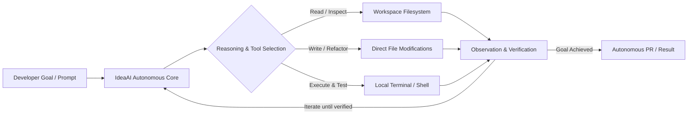

<p align="center">
  <h1 align="center">IdeaAI</h1>
  <p align="center"><strong>Your Open-Source Autonomous Desktop AI Engineer</strong></p>
  <p align="center">
    An autonomous engineering agent designed to handle repetitive software engineering tasks, generate and refactor production code, and execute terminal workflows right on your machine.
  </p>
</p>

<p align="center">
  <a href="#quick-start">Quick Start</a> •
  <a href="#key-features">Key Features</a> •
  <a href="#architecture--how-it-works">Architecture</a> •
  <a href="#cli-usage">CLI Usage</a> •
  <a href="#community--contributing">Contributing</a> •
  <a href="#license">License</a>
</p>

---

## 🚀 Quick Start

Get up and running in **under 2 minutes** with your local repository:

```bash
# 1. Clone the repository
git clone https://github.com/DogusTech/ideaai.git
cd ideaai

# 2. Install dependencies & setup environment
pnpm install
cp .env.example .env.local

# 3. Launch the autonomous agent CLI
node bin/ideaai "Analyze my repo architecture and list optimization targets"

# Or run the desktop interface:
pnpm run dev
```

> **Zero setup required for local offline mode:** IdeaAI connects directly to your local [Ollama](https://ollama.com) instance (`llama3.2` or any open model). No paid API keys or cloud accounts needed!

---

## ⚡ Key Features

- **Autonomous Loop & File Execution:** IdeaAI reads, edits, writes, and tests code files directly in your workspace—acting like a real engineer pair programming alongside you.
- **Privacy-First & 100% Offline Support:** Powered natively by local LLM engines (Ollama, local Llama 3) with zero data leaving your computer.
- **Desktop & Native Terminal Access:** Seamless integration with your local filesystem, bash/powershell terminals, and development toolchain.
- **Developer Tool Integrations:** Built-in connection hooks for GitHub, Slack, Notion, Figma, Google Drive, Calendar, and Vercel.
- **Hybrid Day & Night Engine:** Work interactively on your desktop during the day; let IdeaAI triage failing tests, open PRs, and review commits while you sleep.

---

## 🏗 Architecture / How It Works

IdeaAI executes an autonomous, deterministic cycle with full workspace safety constraints:



### The Autonomous Cycle:
1. **Observe & Index:** Scans the designated repository tree, respects `.gitignore`, and resolves dependency trees.
2. **Reason:** Breaks down complex tasks into atomic file reads, code replacements, and build/test commands.
3. **Act:** Emits precise `<read_file>`, `<write_file>`, and `<run_command>` actions directly inside the sandbox.
4. **Self-Correct:** Verifies command output and compiler errors, iterating automatically until the task passes.

---

## 💻 CLI Usage

IdeaAI includes a zero-dependency CLI located in `bin/ideaai`:

```bash
# Run a direct task
node bin/ideaai "Create a JWT verification middleware in src/auth.ts and add unit tests"

# Specify a custom model or provider
node bin/ideaai "Refactor database queries" --provider openai --model gpt-4o

# Continuous interactive mode
node bin/ideaai --interactive
```

---

## 🤝 Community & Contributing

We welcome contributions from the developer community! Whether you want to add new tool connectors, optimize the local inference pipeline, or improve UI themes:

1. **Fork the repo** and create your branch: `git checkout -b feature/amazing-idea`
2. **Test your changes:** Verify CLI execution and desktop build: `pnpm run build`
3. **Submit a Pull Request** via GitHub PRs with a clear explanation of your improvements.
4. Found a bug or have an idea? Open an issue on [GitHub Issues](https://github.com/DogusTech/ideaai/issues).

---

## 📌 Notice

> **Coming Soon:** Interactive GIFs, demo walkthrough videos, and extended cross-platform desktop installer packages (macOS, Windows, Linux) are actively being prepared for upcoming releases!

---

## 📄 License

This project is licensed under the [MIT License](LICENSE).
